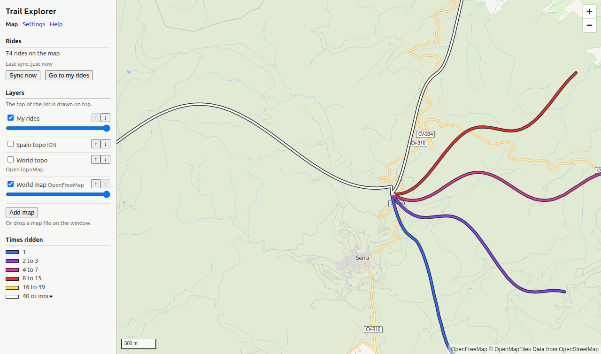

# Trail Explorer

See everywhere you have ridden on one map.

Trail Explorer is a desktop app for macOS and Linux. It downloads your rides from Garmin Connect and draws them as a heatmap: each section of trail is colored by how many times you have ridden it.


<sub>Screenshot from the end-to-end test, with made-up rides.</sub>

## Features

- **Heatmap of every ride.** Each pass counts, so five laps count as five and an out-and-back counts as two. Colors run from blue (ridden once) to white (40 times or more).
- **Syncs from Garmin.** Uses your Garmin personal API key and picks up new rides on its own. It includes every activity with GPS (rides, hikes, runs, ski days and so on) and leaves out virtual and indoor ones. Untick kinds of activity in the sidebar to leave them off the heatmap.
- **Import an export .zip.** In Settings, add rides from Garmin's "Export your data" .zip or a Strava export (.fit, .gpx and .tcx files, gzipped or not, zips inside zips included). Rides you already have, from Garmin sync or an earlier import, are matched by start time and left out, and Garmin sync won't download imported rides again. The .zip is only read; just the new rides are kept.
- **Map layers.** The world map (OpenFreeMap), a world topo map (OpenTopoMap) and a Spain topo map (IGN). You can switch each one on or off, reorder them and set how see-through they are. Ride lines and road and trail lines also have a line width slider.
- **Offline maps.** Add a `.pmtiles` or `.mbtiles` map, or the `.zip` that [BBBike](https://extract.bbbike.org) sends, for a detailed map that works without internet.
- **Excluded zones.** Hide places such as around home: click the map to place a circle, or draw any shape in a GeoJSON file. Rides are cut where they enter a zone.
- **Roads and trails in an area.** Draw circles or rectangles on the map to get every road, track, cycleway and trail inside them, with length, surface and difficulty, from OpenStreetMap through the free [Overpass API](https://wiki.openstreetmap.org/wiki/Overpass_API). A circle takes two clicks (centre, then edge), and so does a rectangle (two opposite corners). Areas are kept and listed in the sidebar, where each can be named, turned off, filtered by kind or deleted. Shapes that cover one place can go in a group, kept separate or joined into one area with one outline and one list of roads and trails; circles and rectangles can be mixed. The outline colour, thickness and style (solid, dashed or dotted) are set in Customize. Data downloads in the background and is shared: areas that overlap never download or store it twice. Needs the internet, and sends each area's position to that server.
- **Route planner.** A separate mode for planning rides in your areas. Pick the areas, click a start (and a finish, or loop back), set a distance and optionally climbing and the steepest climb and descent, and get three to five routes that mix trails you have ridden with ones you haven't. Each has a difficulty rating with reasons, distance, climbing and descent in metric and imperial, the share of new trail, warnings for very steep parts, and an elevation profile. Save the ones you like; the Routes screen lists them in a sortable table, where they can be renamed, viewed or downloaded as `.gpx`. See [Route planning](#route-planning).
- **Portable config.** Colors, start view, zoom limits, layers, offline maps and zones live in one folder of plain JSON files. Edit them in the app's Customize screen or by hand, and copy the folder to another computer.
- **Private.** Rides stay on your computer. The Garmin key is encrypted with your system keychain and sent only to Garmin.

## Install

There are no published downloads yet, so build it yourself (see [Development](#development) for setup):

| System | Command | Output |
|---|---|---|
| Linux (x64, Debian or Ubuntu) | `npm run package:linux` | `dist/<version>/trail-explorer_<version>_amd64.deb` |
| macOS (Apple silicon) | `npm run package:macos` | `dist/<version>/Trail Explorer-<version>-arm64.dmg` |

On Linux, install the package with:

```sh
sudo apt install ./dist/0.1.1/trail-explorer_0.1.1_amd64.deb
```

The package also installs an AppArmor profile, so the app runs on Ubuntu 24.04 and later without any extra setup.

On Linux the key is stored with GNOME Keyring or KWallet. Standard Ubuntu, Fedora and KDE desktops already run one. If none is running, Trail Explorer will not save the key, because without a keyring it could not encrypt it properly.

## Getting started

1. Sign in to [Garmin Connect](https://connect.garmin.com) on the web.
2. Open **Settings → Personal API Key → Create Key**. Choose one year, the longest Garmin offers.
3. Copy the key and paste it into Trail Explorer. Garmin shows it only once.

The first sync downloads every ride Garmin returns, which seems to be about the last three years. Later syncs only fetch new rides. Once you have added the key's expiry date, the app reminds you two weeks before it runs out.

### Adding a detailed offline map

1. Go to [extract.bbbike.org](https://extract.bbbike.org) and draw a box around your area.
2. Choose the format **PMTiles Shortbread** (MBTiles Shortbread works too) and enter your email address.
3. When the link arrives, download the `.zip`, then use **Add map** in Trail Explorer or drop the file on the window. You don't need to unzip it.

## Route planning

Open **Route planner →** under Roads and trails in the sidebar. It is a separate mode, with a blue bar across the top; **← Back to the map** returns.

1. **Areas:** tick the circles and rectangles to plan in. The app reads their paths, works out which you have ridden (any activity shown on the heatmap, within about 20 m and going the same way), and downloads elevation for them.
2. **Start and finish:** a loop back to the start, or a start and a separate finish. Click the map to place them.
3. **Your ride:** distance in km or miles, give or take a tolerance (± 5 km unless changed; routes within it come first, closest first), climbing in metres or feet (optional), the steepest climb and steepest descent allowed in % (each optional: routes never climb or go down anything steeper than its limit, measured over 50 m, but may ride it the other way), how much new trail (a little, some, lots), which kinds of path, and whether to allow paths marked private or no bikes (off by default).
   Optionally, **include a long descent**: one continuous stretch downhill of at least a set length (say 10 km), never climbing more than a set height above its lowest point so far (25 m by default) and dropping at least a set average steepness (3% or more). It uses the paths chosen, plus roads of up to 500 m to join trails. If the areas have none that long, the planner refuses and says how long the longest is. Works in magic mode too, within the difficulty's steepness limits.
4. **Pick a route:** three to five routes, best first. Click one to see it, open its elevation profile, and save it. **Generate new routes** asks for a different set from the same request, leaving out the ones already shown.

Step 3 also has a **difficulty** (Easy, Moderate, Hard, Very hard), which puts routes rated that way first, and a **Normal / ✨ Magic** switch. Magic shows only what it uses (distance, difficulty and favourite trails) and hides the rest until you switch back, which keeps what you had entered. In magic, only the distance and difficulty count, with the same tolerance either side of the distance. Everything else is chosen to suit the difficulty, from the same thresholds routes are rated by: the steepest climbs and descents (Easy up to 12% up and 14% down, Moderate 19% and 22%, Hard 27% and 32%, Very hard any), how technical the paths may be on the mtb scale, and about how much climbing per km. It tries several distances and mixes of new trail and keeps the routes closest to what was asked; if none fit exactly, it says how the closest ones differ.

Under the map key, **Paths you've ridden** highlights them in blue, darkens them, colours them like the heatmap by how many times you have ridden them (with its legend), or hides the ridden look so they show like any other path.

**Include my favourite trails** in step 3 takes in the paths you have ridden most in the chosen areas: ridden at least twice, and in your most-ridden fifth there or at least half as often as your most-ridden path. Routes join a favourite stretch where it is nearest the start and ride along it (up to a third of the distance), favourites cost the planner less, and routes with about a quarter of their length on them come first. Each card says how much of it is on favourites. Magic routes leave this out, as they use only distance and difficulty.

Routing is deterministic and runs on your computer, on the OpenStreetMap data already downloaded for your areas. The same areas, rides and request always give the same routes; nothing is guessed by AI. Each route aims for a share of new trail rather than all of it, so an area fills in over several rides.

Difficulty (Easy, Moderate, Hard, Very hard) comes from the kinds of path, `mtb:scale` or `sac_scale` where OpenStreetMap has them, climbing per km, total climbing, length, and the steepest climb and descent over 50 m. Parts at 15% or steeper are listed and shaded on the profile.

Elevation comes from the free [Terrain Tiles on AWS](https://registry.opendata.aws/terrain-tiles/) (Mapzen's Terrarium format): about 10 m resolution in the USA, 30 m SRTM in most other places, finer in some. The tiles are kept in the app's data folder (`terrain/`) and only the tile numbers are sent, nothing about you or your rides.

Limitations:

- **Only the areas you choose.** Routes never leave them, and areas that don't touch can't be joined. If an area is too small for the distance asked, the planner says so.
- **OpenStreetMap is the map.** Missing, misplaced or wrongly tagged paths end up in routes. Difficulty tags are often missing, so ratings lean on path type and gradient.
- **Elevation is approximate.** 10–30 m data smooths short, very steep pitches. Climbing can be off by 10–20%, and steep warnings are estimates.
- **Distance is a target.** Routes are usually within about 10–15% of it.
- **"Ridden" is matched, not known.** Paths a few metres apart, or poor GPS, can be counted wrongly. A planned route counts only once you have ridden it and it has synced or been imported.

## Configuration

Everything about how the map looks lives in one config folder:

```
config/
  README.md        what every setting means
  map.json         start view, zoom limits, background color, road data servers
  heatmap.json     color bands, outline, how rides are matched
  layers.json      every layer, top first: your rides, web maps, offline map files
  maps/            offline .pmtiles / .mbtiles files
  zones/           excluded zones, as .geojson files
  areas.json       circles and rectangles to find roads and trails in
```

- **Where it is:** `~/.config/Trail Explorer/config` on Linux and `~/Library/Application Support/Trail Explorer/config` on macOS. Use **Customize → Use another folder…** to choose a different one, or set `TRAIL_CONFIG=/path/to/folder` before starting the app. For example, you can point it at a private git repository you sync between computers.
- **Editing:** use the Customize screen, or edit the files by hand. The app watches the folder and picks up changes as soon as a file is saved.
- **Mistakes:** every file and setting is optional. If a value is wrong, the app shows which file and setting, uses the default for just that setting, and keeps the rest.
- **Comments:** any key starting with `//` is ignored, so `"//": "note to self"` works as a comment.
- **Zones and privacy:** zones show where you live, so keep the folder private. If a zones file has a problem, the heatmap isn't redrawn until it's fixed, so nothing it should hide can show.

### Road and trail data

Downloaded roads and trails are kept in `osm.db` in the app's data folder, not in the config folder: it can grow large, and it can always be downloaded again. It holds one copy of each OpenStreetMap way and node, whichever areas use it:

- `node`: id, longitude, latitude, and an elevation column that is empty for now
- `way`: id, OpenStreetMap tags, and its node ids in order, so ways that meet share a node (ready to become a route graph)
- `tile`: which map tiles (zoom 15, about 1 km) have been downloaded

An area downloads only the tiles it needs that aren't there yet, a few at a time, so a big area survives a restart. Deleting an area removes only the data no other area uses.

[`config.example/`](config.example) has a complete example with every file. Its [README](config.example/README.md) documents every setting.

Reading, checking and applying the config (`src/core/config.ts`, `src/core/zones.ts`, `src/core/roads.ts`) has no Electron or Node code in it, so a web version can use the same files.

## Development

You need [Node.js](https://nodejs.org) 22.12 or newer. The repo has an `.nvmrc`, so with [nvm](https://github.com/nvm-sh/nvm):

```sh
nvm install        # reads .nvmrc
npm ci
```

**Linux (Ubuntu 24.04 and later):** Ubuntu blocks the sandbox Electron uses unless an AppArmor profile allows it. Run this once for each checkout:

```sh
sudo scripts/linux-sandbox.sh
```

It installs `/etc/apparmor.d/trail-explorer-dev` for this folder's copy of Electron. It is the same kind of profile Chrome and VS Code install. Without it, `npm start` and `npm run dev` stop and tell you to run the script.

| Command | What it does |
|---|---|
| `npm run dev` | Runs the app with hot reload. |
| `npm start` | Builds and runs the app once. |
| `npm test` | Runs the unit tests. |
| `npm run typecheck` | Runs the TypeScript checks. |
| `SHOTS=folder node test/e2e.ts` | Drives the real app against a fake Garmin server and saves screenshots to `folder`. |
| `node test/e2e-migrate.ts` | Checks that maps and layer settings from versions before the config folder move into it. |
| `SHOTS=folder node test/e2e-planner.ts` | Drives the route planner against fake trail and elevation servers: plan, save, sort, rename, download and delete routes. |
| `npm run check-garmin-key` | Tests a real Garmin key from the terminal: how far back rides go and how fast downloads are. |

The development copy is named **Trail Explorer Dev**. It has its own data folder and keychain entry, so it never touches the installed app's rides or key. The first time you run `npm run dev`, it copies your rides and config folder (maps and zones included, never the key) from the installed app. Run `npm run dev -- --fresh-copy` to copy them again.

App data is stored in:

- macOS: `~/Library/Application Support/Trail Explorer`
- Linux: `~/.config/Trail Explorer`

### Layout

```
src/core/      FIT parsing, tracks, heatmap builder, config and zones (no Electron)
src/desktop/   Electron main process: Garmin sync, SQLite store, maps, key storage
src/ui/        React renderer, MapLibre map
resources/     Bundled map styles, sprites and fonts
scripts/       Dev runner, sandbox setup, style generator, Garmin key check
config.example/  A complete example config folder
test/          Unit tests, fake Garmin server, end-to-end tests
```

## Credits

World map by [OpenFreeMap](https://openfreemap.org), © OpenMapTiles, data © OpenStreetMap contributors. Topo map by [OpenTopoMap](https://opentopomap.org) (CC BY-SA). Spain topo © [IGN](https://www.ign.es) (CC BY 4.0). Road and trail searches: data © OpenStreetMap contributors (ODbL), via the Overpass API. Elevation: [Terrain Tiles on AWS](https://registry.opendata.aws/terrain-tiles/) (Mapzen; USGS 3DEP, SRTM, GMTED2010, ETOPO1 and others). Fonts: Noto Sans (SIL Open Font License). Icons: VersaTiles and Maki. See [`resources/CREDITS.txt`](resources/CREDITS.txt).

## License

[MIT](LICENSE)
